<p align="center">
  
</p>

<h1 align="center">ProfessionBuddy</h1>

<p align="center">
  An all-in-one profession window for World of Warcraft: Burning Crusade
  Classic Anniversary (2.5.6) and WoW: Forever (1.60.1). See every
  character's recipes and materials, plan what to gather, and request
  crafts from friends and guildmates.
</p>

<p align="center">
  <a href="https://www.curseforge.com/wow/addons/professionbuddy"><strong>Download on CurseForge</strong></a>
  &nbsp;&middot;&nbsp;
  <a href="https://github.com/m4ru92/ProfessionBuddy/issues">Report a bug</a>
</p>

## Screenshots

The screenshots are from WoW: Forever. TBC Classic Anniversary uses the same windows, without the Forever-only options.

### Profession window

|  |  |
| :---: | :---: |
| 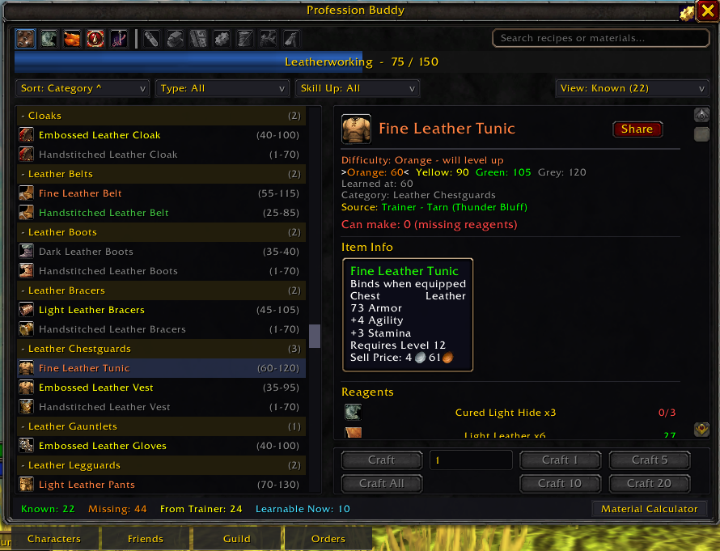 | 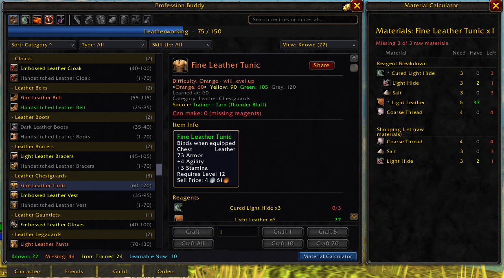 |
| Recipe browser with difficulty colors from client data | Material calculator: full reagent tree and shopping list |
| 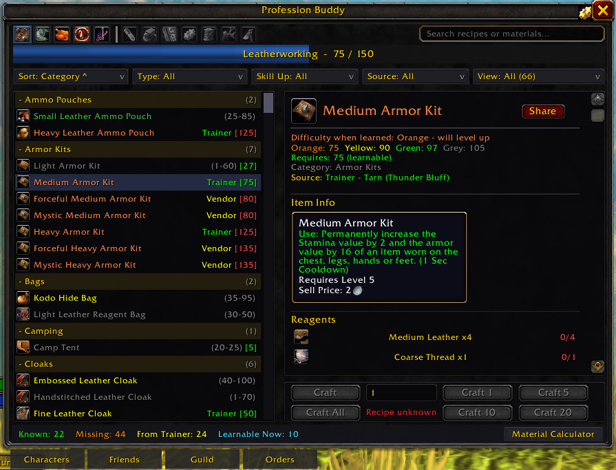 | 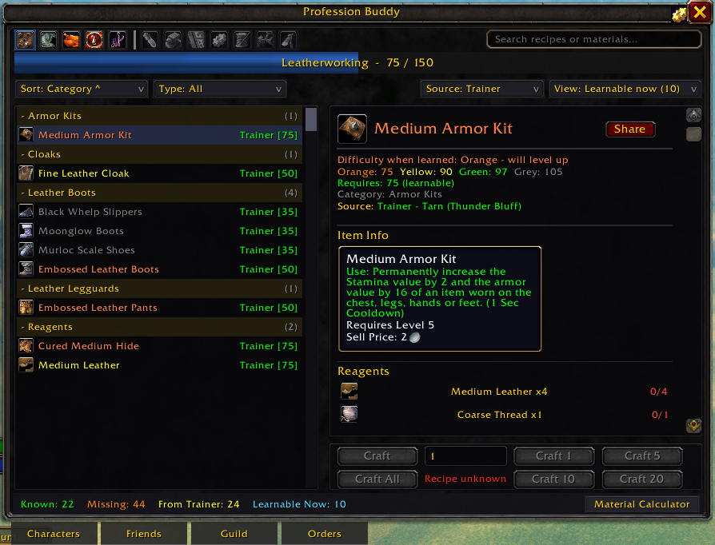 |
| A missing recipe with its learn level and trainer | Learnable now, filtered to trainer recipes |
| 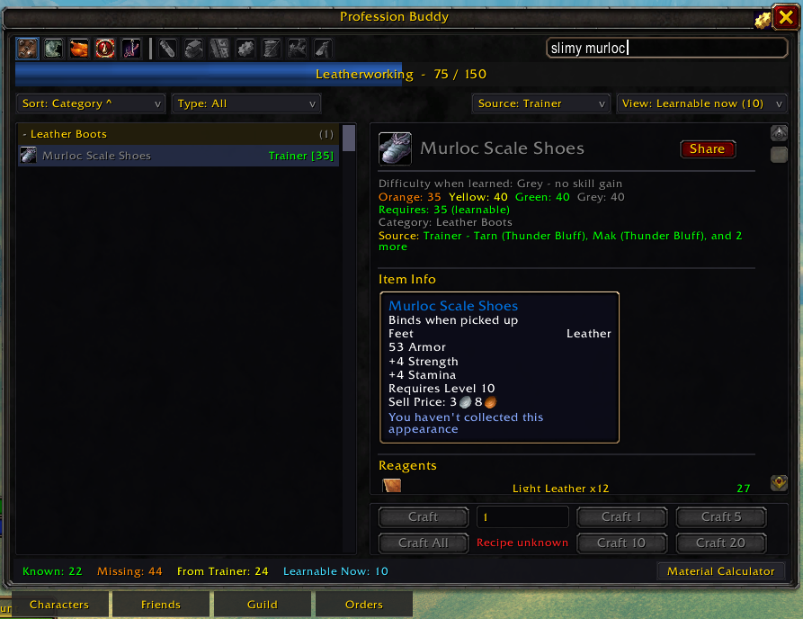 | 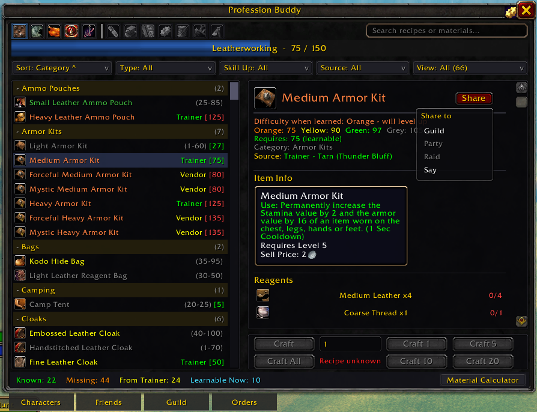 |
| Search by material finds every recipe that uses it | Share a recipe's link to guild, party, raid, or say |

### WoW: Forever

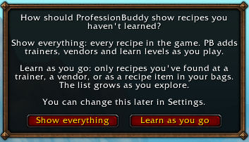

The first time a profession opens, ProfessionBuddy asks how to show the recipes you haven't learned.

### Characters, friends, and guild

|  |  |
| :---: | :---: |
| 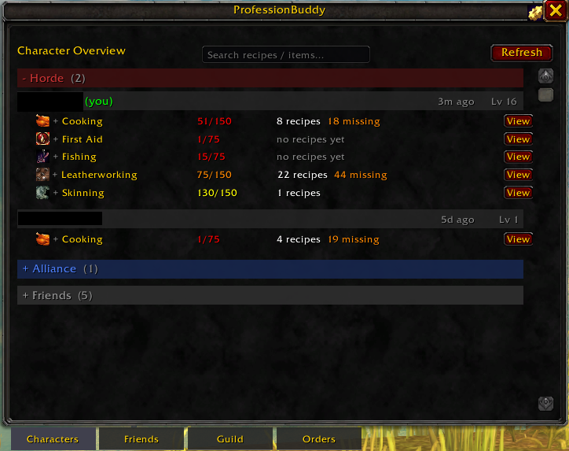 | 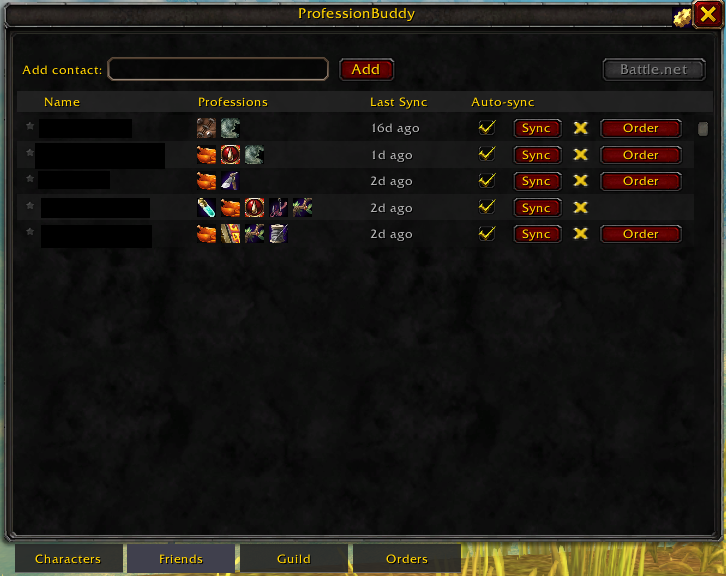 |
| Every character's professions in one view | Friends' professions and materials, synced |
| 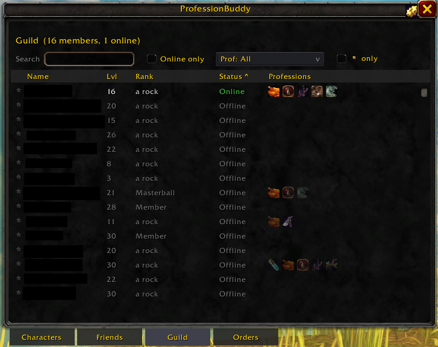 | 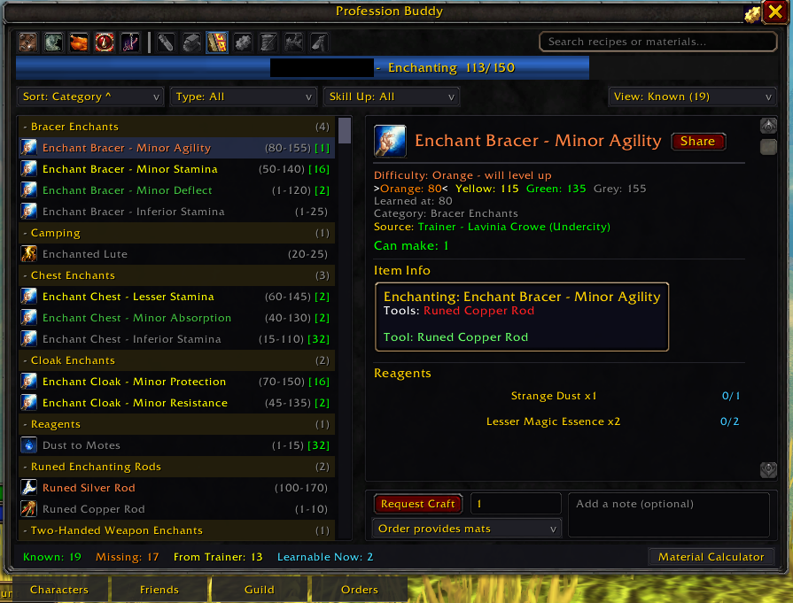 |
| Guildmates' professions | Browse a friend's recipes, see the tool a recipe needs, and request a craft |

### Orders

|  |  |
| :---: | :---: |
| 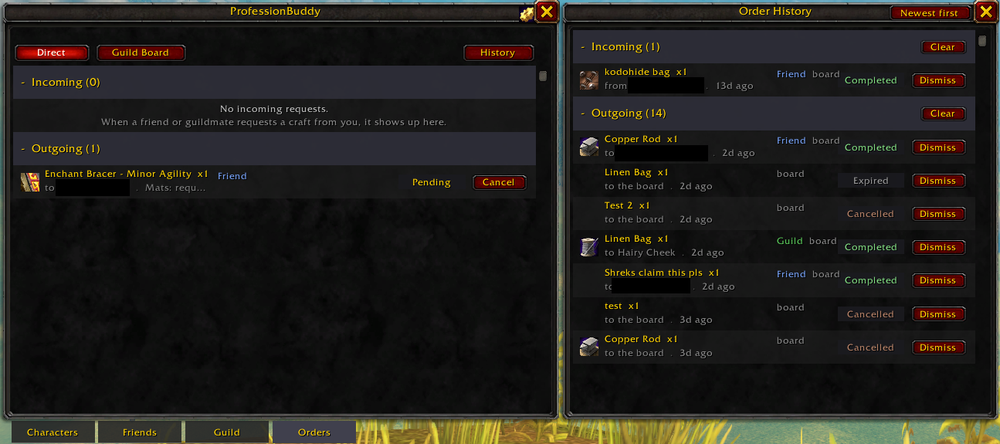 | 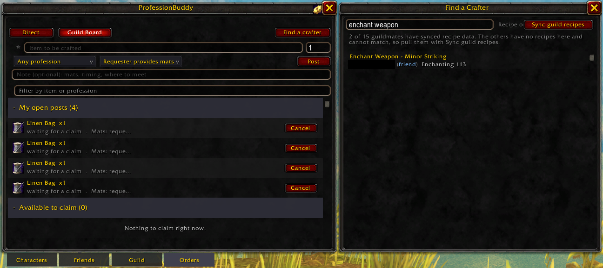 |
| Friend-to-friend crafting orders and order history | Guild order board and Find a Crafter |

### Tooltips

|  |  |  |
| :---: | :---: | :---: |
| 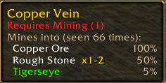 | 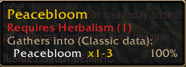 | 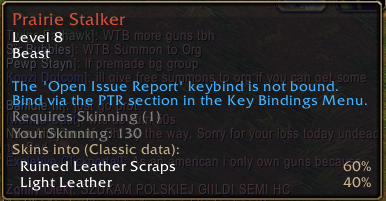 |
| Ore vein: skill needed and loot you gathered | Herb: skill needed and Classic loot data | Skinnable mob: skill needed and Classic loot data |

### Settings

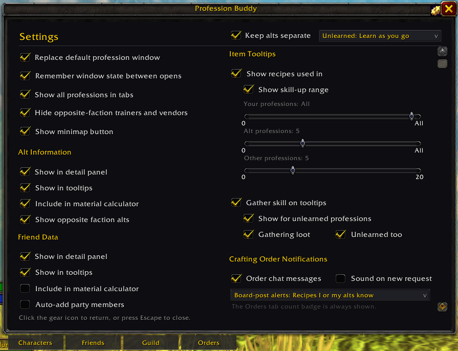

## Features

- **Cross-character view.** See every character's professions, known recipes, and bag and bank inventory in one place, without logging in and out.
- **Material calculator.** Resolves the full reagent tree, including intermediate crafts, subtracts what you already own across your characters, and produces a shopping list.
- **Crafting orders.** Request a craft from a friend or guildmate running ProfessionBuddy. The request, accept, crafted, and received steps run with chat notifications, a queue, and history. If a friend is offline, the order queues and sends the next time you are both online.
- **Guild board.** Post an order to your whole guild, claim what others post, and get a chat line when someone posts a recipe you know. Find a crafter searches your guild by recipe or item.
- **Friends and guild data sharing.** See your contacts', group members' and guildmates' professions, recipes, and materials. On TBC Classic Anniversary, your Battle.net friends' characters can join your contacts as they log in.
- **Search by name or material.** The Search box finds recipes by name or by any material they use. Learnable now lists what you can learn at your current skill.
- **Tooltips.** "Craftable by" shows who can make an item, "Used in" shows which recipes use a reagent, and gathering nodes and skinnable mobs show the skill they need and what they drop.
- **Recipe tools.** Every tool a recipe needs shows in the detail panel, from Enchanting rods to a Blacksmith Hammer, green when a character has one and red when not.
- **Batch crafting.** Craft 1, 5, 10, 20, or all, with a live countdown and skill-bar updates.
- **Share a recipe.** Open the chat box on guild, party, raid, or say with a recipe's link typed.
- **State preservation.** Window position, filters, sort, search, and selection persist between sessions.

### On WoW: Forever

- **Show everything or Learn as you go.** List every recipe in the game, or only the ones you, your alts, or your friends have seen at a trainer, at a vendor, or as a recipe item in your bags. ProfessionBuddy asks the first time a profession opens, and Settings changes it later.
- **Trainers and vendors.** ProfessionBuddy records each trainer and vendor you visit, with learn levels, prices, and stock, and shares them with your friends.
- **Gathering loot from play.** Ore veins, herbs, and skinnable mobs start from Classic data and switch to what you and your friends gathered once you have gathered them 10 times together.

The profession window covers Blacksmithing, Leatherworking, Tailoring, Engineering, Alchemy, Enchanting, Cooking, First Aid, and Mining and Smelting. Rogues get Poisons on both games. TBC Classic Anniversary adds Jewelcrafting. WoW: Forever adds Herbalism, Skinning, and Fishing, and Comprehension for mages. Gathering tooltips cover Mining, Herbalism, and Skinning on both games.

## Installation

- **CurseForge or addon managers:** search "ProfessionBuddy" in your addon manager and install it for automatic updates, or download it from the [CurseForge page](https://www.curseforge.com/wow/addons/professionbuddy).
- **Manual:** download the release zip and extract the `ProfessionBuddy` folder into the game's `Interface/AddOns/` folder. One download serves both games: each loads its own toc.

## Usage

Open a profession, click the minimap button, or type `/pb` (or `/profbuddy`). The gear icon in the window opens Settings, and so does a right click of the minimap button. Your saved data lives in `WTF/.../SavedVariables/ProfessionBuddy.lua`.

## Recipe data

Skill ranges and difficulty colors come from Blizzard's client DB2 (`SkillLineAbility` and `SpellName`) for the 2.5.6 build, via [wago.tools](https://wago.tools). The generated shape is as follows:

```
skillRange = {learn, trivLow, floor((trivLow+trivHigh)/2), trivHigh}
```

Learn levels (the trainer "requires" value) are absent from DB2 (`MinSkillLineRank` is 1), so those come from the trainer. For a later client build, re-pull and regenerate.

WoW: Forever has its own data, baked from that client's DB2 tables by `tools/bake_forever_db2.py`. No TBC data loads there. Learn levels come from trainer captures and from the trainers players visit in game. Gathering data for both games comes from cmangos (TBC) and VMaNGOS (Classic) through `tools/gather_db.py`.

## Bug reports

Install [!BugGrabber](https://www.curseforge.com/wow/addons/bug-grabber) and [BugSack](https://www.curseforge.com/wow/addons/bugsack), reproduce the issue, and open an issue with the full Lua error. Run `/pb bug` for a pre-filled report template.

## Build and packaging

`tools/release.py` builds and checks the release zip: a single `ProfessionBuddy/` folder, the four tocs, and every file they load. It runs the Lua test harnesses, the recipe data linter, and a global-write check first, and the same checks run on GitHub on every push. There is no `.pkgmeta` packager config. Release notes for every version are in [CHANGELOG.md](CHANGELOG.md).

## License

[MIT](LICENSE). Bundled libraries under `Libs/` (LibStub, CallbackHandler-1.0, ChatThrottleLib, and Ace3: AceComm-3.0 and AceSerializer-3.0) retain their own permissive licenses. LibDataBroker-1.1 and LibDBIcon-1.0 (the minimap button) keep their authors' own terms; see [LICENSE](LICENSE).

## Credits

Created by m4ru. Built on the Ace3 library suite.

## Thanks

Major thanks to my friends Blargle and Shrekcheeks, who assisted greatly in testing every build of ProfessionBuddy with me in game on both clients.
